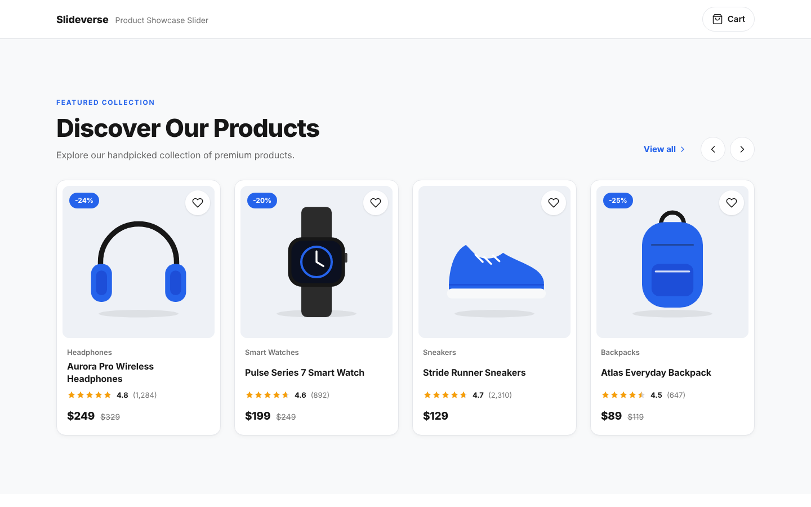
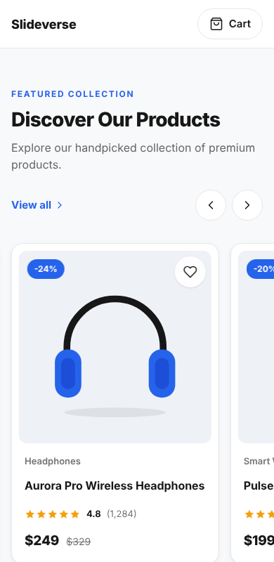
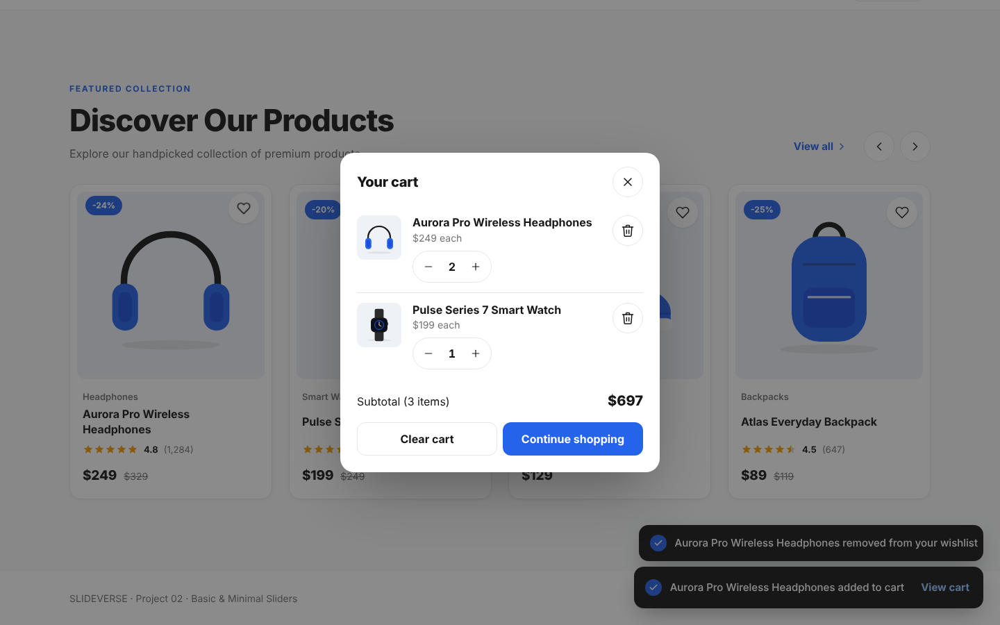

# Product Showcase Slider

**SLIDEVERSE · Project 02 · Basic & Minimal Sliders**

A premium, minimal e-commerce product carousel built with plain HTML5, CSS3 and Vanilla JavaScript (ES2020). No frameworks, no slider libraries, no build step.



## Features

**Slider**
- Smooth horizontal sliding with **infinite looping** (clone-based, so there is never a visible jump).
- Previous / Next buttons, **mouse drag**, **touch swipe** (with flick momentum) and **keyboard** control (`←` `→` `Home` `End`).
- Responsive cards per view: **4** desktop, **3** laptop, **2** tablet, **1.2** mobile (the next card peeks in to signal scrolling). Measured live with `ResizeObserver`.
- Optional **autoplay** (off by default). When enabled it pauses on hover, focus, drag and when the tab is hidden, and shows a pause/play button.
- Optional non-looping mode that disables the arrows at either end (`loop: false`).
- **View all** toggles the same cards into a wrapping grid and back.

**Products**
- 8 sample products, each with image, category, name, star rating, review count, current price, original price, auto-calculated discount badge, wishlist heart and Quick Add button.
- **Wishlist** toggle with heart animation, saved in `localStorage`.
- **Cart**: counter in the header, success toast with a *View cart* action, and a cart dialog with quantity controls, remove, clear and subtotal. Saved in `localStorage`.
- **Quick view** dialog: click a product title (or anywhere on the card) for details.
- Remote photos with a **graceful fallback**: if an image fails to load, a bundled local illustration is shown instead.

**Quality**
- Semantic HTML, ARIA labels, visible focus rings, 44 px minimum touch targets, a live region announcing slider position, `prefers-reduced-motion` support.
- Native `<dialog>` elements (focus trapping, `Esc` to close, focus restored on close).
- Transforms and transitions only. No animation libraries and no layout thrashing.

## Technologies

- HTML5 (semantic markup, `<dialog>`)
- CSS3 (custom properties, flexbox, `aspect-ratio`, `mask`, media queries)
- Vanilla JavaScript ES2020 (modules of functions inside one IIFE, event delegation, Pointer Events, `ResizeObserver`)
- Google Fonts: [Manrope](https://fonts.google.com/specimen/Manrope) (falls back to the system font)
- Product photography from [Unsplash](https://unsplash.com)

## Folder structure

```
product-showcase-slider/
├── index.html
├── css/
│   └── style.css
├── js/
│   └── script.js
├── assets/
│   └── images/
│       ├── *.svg                 # local fallback illustrations (one per product)
│       └── screenshot-*.png      # README screenshots
└── README.md
```

## Installation

There is nothing to install. Download or clone the folder:

```bash
git clone <your-repo-url> product-showcase-slider
cd product-showcase-slider
```

## How to run locally

**Option 1 — open the file.** Double-click `index.html`. Everything works from `file://`.

**Option 2 — a local server** (recommended, closer to production):

```bash
# Python 3
python3 -m http.server 8080

# or Node.js
npx serve .
```

Then open <http://localhost:8080>.

An internet connection is needed for the Google Font and the Unsplash photos. Without it the page still works and uses system fonts and the bundled illustrations.

## Customization guide

### Settings

All behaviour lives in the `CONFIG` object at the top of `js/script.js`:

| Option | Default | What it does |
| --- | --- | --- |
| `loop` | `true` | Infinite looping. Set `false` to stop at the first and last card. |
| `autoplay` | `false` | Turn on automatic sliding. |
| `autoplayDelay` | `4500` | Milliseconds between slides. |
| `slideBy` | `'page'` | `'page'` moves by the number of visible cards; use a number (e.g. `1`) for a fixed step. |
| `swipeThreshold` | `48` | Pixels a slow drag must travel to change slide. |
| `maxQty` | `10` | Maximum units of one product in the cart. |
| `toastDuration` | `2800` | Milliseconds a toast stays visible. |
| `currency` / `locale` | `'USD'` / `'en-US'` | Price formatting. |

### Products

Edit the `PRODUCTS` array in `js/script.js`:

```js
{
  id: 'aurora-pro',                       // unique
  category: 'Headphones',
  name: 'Aurora Pro Wireless Headphones',
  photo: 'photo-1505740420928-5e560c06d30e',  // Unsplash photo id
  fallback: 'assets/images/headphones.svg',   // shown if the photo fails
  alt: 'Aurora Pro over-ear wireless headphones',
  rating: 4.8,
  reviews: 1284,
  price: 249,
  originalPrice: 329,                     // or null: no discount badge
  description: 'Shown in the quick view dialog.',
}
```

To use your own images, set `photo` to a full URL by changing `imageUrl()`, or point `fallback` at a local file and skip the remote photo. Keep **more than 4 products** when `loop` is on.

### Look and feel

Design tokens are CSS custom properties at the top of `css/style.css` (`--accent`, `--text`, `--border`, `--radius-card`, …).

Cards per view and spacing are set per breakpoint in the "Section header" part of the stylesheet:

```css
.showcase { --per-view: 4; --gap: 24px; }
@media (max-width: 1279px) { .showcase { --per-view: 3; } }
@media (max-width: 1023px) { .showcase { --per-view: 2; --gap: 20px; } }
@media (max-width: 639px)  { .showcase { --per-view: 1.2; --gap: 16px; } }
```

`--gap` must stay in `px` because the script reads it. The script picks up changes automatically.

## Screenshots

| Desktop | Mobile | Cart |
| --- | --- | --- |
|  |  |  |

*Screenshots show the bundled fallback illustrations. With internet access the cards show Unsplash photography.*

## Browser support

Current versions of Chrome, Edge, Firefox and Safari (16+). Uses `<dialog>`, `ResizeObserver`, Pointer Events, `overflow: clip` and `:has()` (with graceful fallbacks).

## License

MIT License. Copyright (c) 2026 SLIDEVERSE.

Permission is hereby granted, free of charge, to any person obtaining a copy of this software and associated documentation files (the "Software"), to deal in the Software without restriction, including without limitation the rights to use, copy, modify, merge, publish, distribute, sublicense, and/or sell copies of the Software, and to permit persons to whom the Software is furnished to do so, subject to the following conditions:

The above copyright notice and this permission notice shall be included in all copies or substantial portions of the Software.

THE SOFTWARE IS PROVIDED "AS IS", WITHOUT WARRANTY OF ANY KIND, EXPRESS OR IMPLIED, INCLUDING BUT NOT LIMITED TO THE WARRANTIES OF MERCHANTABILITY, FITNESS FOR A PARTICULAR PURPOSE AND NONINFRINGEMENT. IN NO EVENT SHALL THE AUTHORS OR COPYRIGHT HOLDERS BE LIABLE FOR ANY CLAIM, DAMAGES OR OTHER LIABILITY, WHETHER IN AN ACTION OF CONTRACT, TORT OR OTHERWISE, ARISING FROM, OUT OF OR IN CONNECTION WITH THE SOFTWARE OR THE USE OR OTHER DEALINGS IN THE SOFTWARE.
